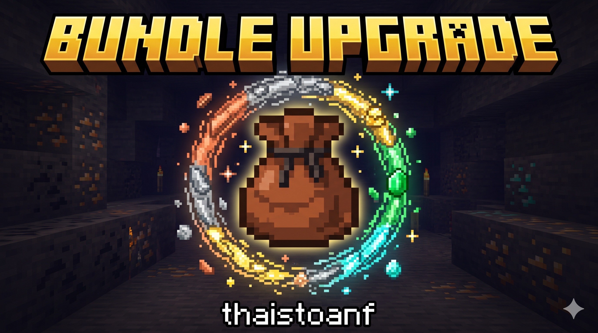

<div id="top" align="center">
  

# Bundle Upgrade

  <p>
    <strong>Nâng cấp sức chứa túi Bundle tuần tự cho Minecraft Fabric 1.20.5</strong><br/>
    <em>Sequential Bundle Storage Upgrades for Minecraft Fabric 1.20.5</em>
  </p>

  <p>
    <a href="../../actions"></a>
    <a href="../../releases"></a>
    <a href="https://minecraft.net/"></a>
    <a href="https://fabricmc.net/"></a>
    <a href="https://adoptium.net/"></a>
  </p>

  <p>
    <a href="#tài-liệu-tiếng-việt"></a>
    <a href="#english-documentation"></a>
    <a href="../../releases/latest"></a>
    <a href="https://github.com/thaistoanf"></a>
  </p>
</div>

---

## Tài Liệu Tiếng Việt

### Giới Thiệu

**Bundle Upgrade** là mod mở rộng tính năng của túi đồ Bundle trong Minecraft Fabric 1.20.5. Thay vì bị giới hạn ở 64 vật phẩm như túi da cơ bản, bạn có thể nâng cấp tuần tự chiếc túi của mình qua **5 bậc kim loại và đá quý**: **Đồng -> Sắt -> Vàng -> Ngọc Lục Bảo -> Kim Cương**.

| Thông tin                      | Giá trị                               |
| :----------------------------- | :------------------------------------ |
| **Phiên bản mod hiện tại**     | `1.0.0`                               |
| **Phiên bản Minecraft hỗ trợ** | `1.20.5`                              |
| **Mod Loader**                 | Fabric Loader `0.20.1+` và Fabric API |
| **Yêu cầu Java**               | Java 21 (`JDK 21`)                    |

> [!IMPORTANT]
> **Giữ nguyên 100% vật phẩm khi nâng cấp:** Khi đưa túi Bundle đang chứa đầy vật phẩm vào Bàn Chế Tạo (Crafting Table) cùng nguyên liệu nâng cấp, chiếc túi mới tạo ra sẽ giữ nguyên toàn bộ vật phẩm bên trong (`BUNDLE_CONTENTS`) cũng như tên tùy chỉnh (`CUSTOM_NAME` từ Đe). Bạn không bao giờ phải đổ đồ ra ngoài khi nâng cấp!

---

### Bảng Cấp Độ & Công Thức Nâng Cấp Tuần Tự

Tất cả công thức đều thực hiện trên **Bàn Chế Tạo 3x3**: Đặt **Túi bậc trước ở chính giữa ô số 5**, và bao quanh bằng **8 nguyên liệu tương ứng ở 8 ô xung quanh**.

|  Bậc  | Tên Túi                 | Định Danh (Item ID)            | Công Thức Chế Tạo (Bàn 3x3)                                                              | Cộng Dồn | Tổng Sức Chứa  |
| :---: | :---------------------- | :----------------------------- | :--------------------------------------------------------------------------------------- | :------: | :------------: |
| **0** | **Bundle Mặc Định**     | `minecraft:bundle`             | 1x Da thỏ + 1x Sợi chỉ (Vanilla)                                                         |   `+0`   | **64** đơn vị  |
| **1** | **Bundle Đồng**         | `bundleupgrade:copper_bundle`  | **Giữa:** `minecraft:bundle`<br/>**Xung quanh (x8):** Phôi Đồng (`Copper Ingot`)         |  `+10`   | **74** đơn vị  |
| **2** | **Bundle Sắt**          | `bundleupgrade:iron_bundle`    | **Giữa:** `bundleupgrade:copper_bundle`<br/>**Xung quanh (x8):** Phôi Sắt (`Iron Ingot`) |  `+20`   | **94** đơn vị  |
| **3** | **Bundle Vàng**         | `bundleupgrade:gold_bundle`    | **Giữa:** `bundleupgrade:iron_bundle`<br/>**Xung quanh (x8):** Phôi Vàng (`Gold Ingot`)  |  `+30`   | **124** đơn vị |
| **4** | **Bundle Ngọc Lục Bảo** | `bundleupgrade:emerald_bundle` | **Giữa:** `bundleupgrade:gold_bundle`<br/>**Xung quanh (x8):** Ngọc Lục Bảo (`Emerald`)  |  `+40`   | **164** đơn vị |
| **5** | **Bundle Kim Cương**    | `bundleupgrade:diamond_bundle` | **Giữa:** `bundleupgrade:emerald_bundle`<br/>**Xung quanh (x8):** Kim Cương (`Diamond`)  |  `+50`   | **214** đơn vị |

---

### Hướng Dẫn Sử Dụng & Cơ Chế Hoạt Động

#### 1. Thao Tác Cất & Lấy Đồ (Chuẩn Vanilla 1.20.5)

| Thao tác                                        | Cách thực hiện                                                                                                                                          |
| :---------------------------------------------- | :------------------------------------------------------------------------------------------------------------------------------------------------------ |
| **Cất vật phẩm (Chuột phải)**                   | Cầm vật phẩm trên con trỏ rồi **nhấp chuột phải** vào túi Bundle, hoặc cầm túi Bundle trên con trỏ rồi **nhấp/kéo chuột phải** qua các ô chứa vật phẩm. |
| **Lấy vật phẩm ra (Chuột phải)**                | Để trống con trỏ và **nhấp chuột phải** vào túi Bundle để lấy 1 stack đầu tiên ra ngoài.                                                                |
| **Đặt vào ô trống (Chuột phải)**                | Cầm túi Bundle trên con trỏ và **nhấp chuột phải** vào một ô trống để đặt 1 stack từ túi vào ô đó.                                                      |
| **Rải đồ ra nhiều ô (Giữ chuột phải + kéo)**    | Cầm túi Bundle trên con trỏ, **giữ chuột phải và kéo** qua các ô trống: mỗi ô trống đi qua sẽ nhận 1 stack từ túi.                                      |
| **Đổ đồ ra thế giới (Chuột phải ngoài hòm đồ)** | Cầm túi trên tay và **nhấp chuột phải** để thả toàn bộ các stack bên trong ra thế giới.                                                                 |

#### 2. Quy Tắc Trọng Lượng (Hệ Thống Base-64)

Sức chứa của Bundle tính theo đơn vị trọng lượng chuẩn:

- **Vật phẩm stack tối đa 64** (khối xây dựng, khoáng sản, hạt giống...): Chiếm **1 đơn vị / món** (`1/64`).
- **Vật phẩm stack tối đa 16** (ngọc Ender, bóng tuyết, xô rỗng, biển báo...): Chiếm **4 đơn vị / món** (`4/64`).
- **Vật phẩm không thể stack** (công cụ, vũ khí, áo giáp, sách phù phép...): Chiếm **64 đơn vị / món** (`64/64`).
  > [!TIP]
  > Nhờ các bậc túi nâng cấp mở rộng từ **74 đến 214 đơn vị**, bạn hoàn toàn có thể bỏ cả 1 cây kiếm hay 1 chiếc cúp (64 đơn vị) vào trong túi mà vẫn còn thừa từ 10 đến 150 đơn vị cho các vật phẩm khác!

#### 3. Tự Động Chia Stack (Từ 1.0.1)

Khi cất hơn 64 vật phẩm giống nhau (ví dụ 200 khối đá vào Bundle Kim Cương), túi sẽ tự động chia thành nhiều stack chuẩn (`64 + 64 + 64 + 8`) trong `BundleContentsComponent` thay vì gộp thành 1 stack vượt quá giới hạn codec. Mỗi lần lấy ra luôn chỉ nhận tối đa 1 stack chuẩn.

#### 4. Thanh Hiển Thị & Chú Giải (UI & Tooltip)

- **Thanh đo độ đầy (Fullness Bar):** Thanh hiển thị dưới đáy biểu tượng túi co giãn tỉ lệ chính xác `Số lượng hiện tại / Sức chứa tối đa của bậc`, chuyển sang màu đỏ khi đầy.
- **Tooltip thông minh:** Hiển thị trực quan trạng thái túi dưới dạng văn bản `Hiện có / Tối đa` (Ví dụ: `64 / 74`, `180 / 214`...).

---

### Hướng Dẫn Cài Đặt & Biên Dịch (Build)

#### Cài Đặt Để Chơi Game

1. Cài đặt **Minecraft 1.20.5**.
2. Cài đặt **Fabric Loader 0.20.1** trở lên.
3. Tải **Fabric API** phù hợp với phiên bản 1.20.5.
4. Trong Minecraft 1.20.5, túi Bundle mặc định nằm trong mục **Experiments**: hãy bật **Bundle** khi tạo thế giới mới.
5. Tải file `.jar` của mod từ [Releases](../../releases/latest) và đặt vào thư mục `.minecraft/mods`.

#### Tự Biên Dịch Từ Mã Nguồn (Build from Source)

Yêu cầu hệ thống đã cài đặt **Java 21 (JDK 21)**:

```bash
# Clone dự án
git clone https://github.com/thaistoanf/Bundle-Upgrade.git
cd Bundle-Upgrade

# Biên dịch bằng Gradle Wrapper
./gradlew clean build
```

File `.jar` hoàn chỉnh sau khi build thành công sẽ nằm tại: `build/libs/bundleupgrade-fabric-1.20.5-1.0.1.jar`.

---

## English Documentation

### Overview

**Bundle Upgrade** expands the storage capabilities of Minecraft 1.20.5 bundles. Rather than being confined to the vanilla limit of 64 items, you can upgrade your bundle sequentially across **5 tiers**: **Copper -> Iron -> Gold -> Emerald -> Diamond**.

| Info                             | Value                                   |
| :------------------------------- | :-------------------------------------- |
| **Current mod version**          | `1.0.1`                                 |
| **Supported Minecraft versions** | `1.20.5`                                |
| **Mod loader**                   | Fabric Loader `0.20.1+` with Fabric API |
| **Java requirement**             | Java 21 (`JDK 21`)                      |

> [!IMPORTANT]
> **100% Item Retention:** Upgrading a bundle on a Crafting Table safely transfers all stored contents (`BUNDLE_CONTENTS`) and custom anvil names (`CUSTOM_NAME`) directly to the newly crafted tier. You never have to empty your bundle before upgrading!

---

### Sequential Upgrade Tiers & Recipes Table

All recipes use a **3x3 Crafting Table**: Place the **previous tier bundle in center slot 5**, surrounded by **8 tier upgrade materials in all outer slots**.

| Tier  | Bundle Name        | Item Identifier                | 3x3 Crafting Recipe                                                            | Extra Cap | Max Capacity  |
| :---: | :----------------- | :----------------------------- | :----------------------------------------------------------------------------- | :-------: | :-----------: |
| **0** | **Vanilla Bundle** | `minecraft:bundle`             | 1x Rabbit Hide + 1x String (Vanilla)                                           |   `+0`    | **64** units  |
| **1** | **Copper Bundle**  | `bundleupgrade:copper_bundle`  | **Center:** `minecraft:bundle`<br/>**Surrounding (x8):** Copper Ingot          |   `+10`   | **74** units  |
| **2** | **Iron Bundle**    | `bundleupgrade:iron_bundle`    | **Center:** `bundleupgrade:copper_bundle`<br/>**Surrounding (x8):** Iron Ingot |   `+20`   | **94** units  |
| **3** | **Gold Bundle**    | `bundleupgrade:gold_bundle`    | **Center:** `bundleupgrade:iron_bundle`<br/>**Surrounding (x8):** Gold Ingot   |   `+30`   | **124** units |
| **4** | **Emerald Bundle** | `bundleupgrade:emerald_bundle` | **Center:** `bundleupgrade:gold_bundle`<br/>**Surrounding (x8):** Emerald      |   `+40`   | **164** units |
| **5** | **Diamond Bundle** | `bundleupgrade:diamond_bundle` | **Center:** `bundleupgrade:emerald_bundle`<br/>**Surrounding (x8):** Diamond   |   `+50`   | **214** units |

---

### How to Use & Mechanics

#### 1. Controls (Vanilla 1.20.5 Bundle Mechanics)

| Action                                     | How                                                                                                                                         |
| :----------------------------------------- | :------------------------------------------------------------------------------------------------------------------------------------------ |
| **Insert (Right-Click)**                   | Hold an item on your cursor and **right-click** the bundle, or hold the bundle on your cursor and **right-click / drag** across item slots. |
| **Extract (Right-Click)**                  | With an empty cursor, **right-click** the bundle to take out one stack.                                                                     |
| **Place into an empty slot (Right-Click)** | Hold the bundle on your cursor and **right-click** an empty slot to place one stack from the bundle into it.                                |
| **Distribute (Right-Click & Drag)**        | Hold the bundle on your cursor, then **hold right-click and drag** across empty slots: each empty slot receives one stack from the bundle.  |
| **Empty into the world (Use)**             | Hold the bundle in your hand and **right-click** in the world to drop all stored stacks at once.                                            |

#### 2. Capacity Weight Rules (Base-64 Unit System)

Occupancy is calculated using standard base-64 fractions:

- **Stack size 64 items** (building blocks, minerals, seeds...): **1 unit / item** (`1/64` weight).
- **Stack size 16 items** (ender pearls, snowballs, empty buckets...): **4 units / item** (`4/64` weight).
- **Unstackable items** (tools, weapons, armor, enchanted books...): **64 units / item** (`64/64` weight).
  > [!TIP]
  > Since upgraded bundles feature capacities from **74 to 214 units**, you can store unstackable gear (such as a sword or pickaxe, taking 64 units) while still having 10 to 150 units of remaining space for other items!

#### 3. Automatic Stack Splitting (Since 1.0.1)

When you store more than 64 identical items (for example 200 stone in a Diamond Bundle), the bundle automatically splits them across multiple standard stacks (`64 + 64 + 64 + 8`) inside `BundleContentsComponent` instead of merging into a single oversized stack. Every extraction returns at most one standard stack (`<= 64`).

#### 4. Fullness Bar & Dynamic Tooltips

- **Item Fullness Bar:** The gauge below the bundle item dynamically scales to `currentUnits / maxCapacity` of that tier without overflow or visual glitches.
- **Informative Tooltips:** Displays exact occupancy numbers in `Current / Max` format (e.g., `64 / 74`, `180 / 214`...).

---

### Installation & Building from Source

#### Playing the Mod

1. Install **Minecraft 1.20.5**.
2. Install **Fabric Loader 0.20.1** or newer.
3. Install the matching **Fabric API** for 1.20.5.
4. In Minecraft 1.20.5, the vanilla Bundle is an experimental feature: enable the **Bundle** experiment when creating a world.
5. Place the downloaded `.jar` file from [Releases](../../releases/latest) into your `.minecraft/mods` directory.

#### Compiling from Source

Requires **Java 21 (JDK 21)** installed on your machine:

```bash
# Clone the repository
git clone https://github.com/thaistoanf/Bundle-Upgrade.git
cd Bundle-Upgrade

# Compile using Gradle Wrapper
./gradlew clean build
```

The output JAR file will be located at `build/libs/bundleupgrade-fabric-1.20.5-1.0.1.jar`.

---

<div align="center">
  <p>Developed by <strong>thaistoanf</strong></p>
  <p>
    <a href="#top"></a>
  </p>
</div>
