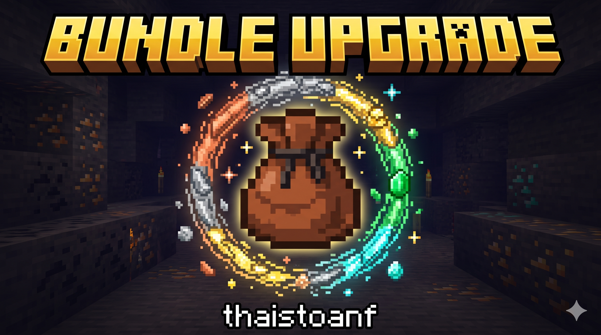

<div id="top" align="center">
  

# Bundle Upgrade

  <p>
    <strong>Nâng cấp sức chứa túi Bundle tuần tự cho Minecraft Fabric 1.21.11</strong><br/>
    <em>Sequential Bundle Storage Upgrades for Minecraft Fabric 1.21.11</em>
  </p>

  <p>
    <a href="../../actions"></a>
    <a href="../../releases"></a>
    <a href="https://minecraft.net/"></a>
    <a href="https://fabricmc.net/"></a>
    <a href="https://adoptium.net/"></a>
  </p>

  <p>
    <a href="#-tài-liệu-tiếng-việt"></a>
    <a href="#-english-documentation"></a>
    <a href="../../releases/latest"></a>
    <a href="https://github.com/thaistoanf"></a>
  </p>
</div>

---

## 🇻🇳 Tài Liệu Tiếng Việt

### Giới Thiệu

**Bundle Upgrade** là mod mở rộng tính năng của túi đồ Bundle trong Minecraft Fabric 1.21.11. Thay vì bị giới hạn ở 64 vật phẩm như túi da cơ bản, bạn có thể nâng cấp tuần tự chiếc túi của mình qua **5 bậc kim loại và đá quý**: **Đồng ➔ Sắt ➔ Vàng ➔ Ngọc Lục Bảo ➔ Kim Cương**.

> [!IMPORTANT]
> **Giữ nguyên 100% vật phẩm khi nâng cấp:** Khi đưa túi Bundle đang chứa đầy vật phẩm vào Bàn Chế Tạo (Crafting Table) cùng nguyên liệu nâng cấp, chiếc túi mới tạo ra sẽ giữ nguyên toàn bộ vật phẩm bên trong cũng như tên tùy chỉnh (Custom Name từ Đe). Bạn không bao giờ phải đổ đồ ra ngoài khi nâng cấp!

---

### Bảng Cấp Độ & Công Thức Nâng Cấp Tuần Tự

Tất cả công thức đều thực hiện trên **Bàn Chế Tạo 3x3**: Đặt **Túi bậc trước ở chính giữa ô số 5**, và bao quanh bằng **8 nguyên liệu tương ứng ở 8 ô xung quanh**.

|  Bậc  | Tên Túi                 | Định Danh (Item ID)            | Công Thức Chế Tạo (Bàn 3x3)                                                              | Cộng Dồn | Tổng Sức Chứa  |
| :---: | :---------------------- | :----------------------------- | :--------------------------------------------------------------------------------------- | :------: | :------------: |
| **0** | **Bundle Mặc Định**     | `minecraft:bundle`             | 1x Da thỏ + 1x Sợi chỉ (Vanilla)                                                         |   `+0`   | **64** đơn vị  |
| **1** | **Bundle Đồng**         | `bundleupgrade:copper_bundle`  | **Giữa:** `minecraft:bundle`<br/>**Xung quanh (x8):** Phôi Đồng (`Copper Ingot`)         |  `+10`   | **74** đơn vị  |
| **2** | **Bundle Sắt**          | `bundleupgrade:iron_bundle`    | **Giữa:** `bundleupgrade:copper_bundle`<br/>**Xung quanh (x8):** Phôi Sắt (`Iron Ingot`) |  `+20`   | **94** đơn vị  |
| **3** | **Bundle Vàng**         | `bundleupgrade:gold_bundle`    | **Giữa:** `bundleupgrade:iron_bundle`<br/>**Xung quanh (x8):** Phôi Vàng (`Gold Ingot`)  |  `+30`   | **124** đơn vị |
| **4** | **Bundle Ngọc Lục Bảo** | `bundleupgrade:emerald_bundle` | **Giữa:** `bundleupgrade:gold_bundle`<br/>**Xung quanh (x8):** Ngọc Lục Bảo (`Emerald`)  |  `+40`   | **164** đơn vị |
| **5** | **Bundle Kim Cương**    | `bundleupgrade:diamond_bundle` | **Giữa:** `bundleupgrade:emerald_bundle`<br/>**Xung quanh (x8):** Kim Cương (`Diamond`)  |  `+50`   | **214** đơn vị |

---

### Hướng Dẫn Sử Dụng & Cơ Chế Hoạt Động

#### 1. Thao Tác Cất & Lấy Đồ (Giữ Nguyên Thao Tác 1.21.11 Vanilla)

- **Cất vật phẩm vào túi:** Cầm vật phẩm trên con trỏ chuột và nhấn chuột phải vào túi Bundle, hoặc cầm túi Bundle rồi quét chuột phải qua các ô vật phẩm trong hòm đồ.
- **Lấy vật phẩm ra:** Nhấp chuột phải vào túi để lấy món đồ được chọn ra ngoài.
- **Chọn món đồ cần lấy (Scroll Wheel Selection):** Khi rê chuột vào túi Bundle có nhiều loại đồ khác nhau, hãy **lăn con lăn chuột (Scroll Wheel)** để cuộn và chọn chính xác món đồ bạn muốn lấy ra trước.

#### 2. Quy Tắc Trọng Lượng (Hệ Thống Base-64)

Sức chứa của Bundle tính theo đơn vị trọng lượng chuẩn:

- **Vật phẩm stack tối đa 64** (khối xây dựng, khoáng sản, hạt giống...): Chiếm **1 đơn vị / món** (`1/64`).
- **Vật phẩm stack tối đa 16** (ngọc Ender, bóng tuyết, xô rỗng, biển báo...): Chiếm **4 đơn vị / món** (`4/64`).
- **Vật phẩm không thể stack** (công cụ, vũ khí, áo giáp, sách phù phép...): Chiếm **64 đơn vị / món** (`64/64`).
  > [!TIP]
  > Nhờ các bậc túi nâng cấp mở rộng từ **74 đến 214 đơn vị**, bạn hoàn toàn có thể bỏ cả 1 cây kiếm hay 1 chiếc cúp (64 đơn vị) vào trong túi mà vẫn còn thừa từ 10 đến 150 đơn vị cho các vật phẩm khác!

#### 3. Thanh Hiển Thị & Chú Giải (UI & Tooltip)

- **Thanh đo độ đầy (Fullness Bar):** Thanh hiển thị dưới đáy biểu tượng túi co giãn tỉ lệ chính xác `Số lượng hiện tại / Sức chứa tối đa của bậc`, chuyển từ màu xanh nhạt sang màu vàng và đỏ khi đầy.
- **Tooltip thông minh:** Hiển thị trực quan trạng thái túi dưới dạng văn bản `Hiện có / Tối đa` (Ví dụ: `64 / 74`, `180 / 214`...).

---

### Hướng Dẫn Cài Đặt & Biên Dịch (Build)

#### Cài Đặt Để Chơi Game

1. Cài đặt **Minecraft 1.21.11**.
2. Cài đặt **Fabric Loader 0.19.5** trở lên.
3. Tải **Fabric API** phù hợp với phiên bản 1.21.11.
4. Tải file `.jar` của mod từ [Releases](../../releases/latest) và đặt vào thư mục `.minecraft/mods`.

#### Tự Biên Dịch Từ Mã Nguồn (Build from Source)

Yêu cầu hệ thống đã cài đặt **Java 21 (JDK 21)**:

```bash
# Clone dự án
git clone https://github.com/thaistoanf/Bundle-Upgrade.git
cd Bundle-Upgrade

# Biên dịch bằng Gradle Wrapper
./gradlew build
```

File `.jar` hoàn chỉnh sau khi build thành công sẽ nằm tại: `build/libs/bundleupgrade-1.0.0.jar`.

---

## English Documentation

### Overview

**Bundle Upgrade** expands the storage capabilities of Minecraft 1.21.11 bundles. Rather than being confined to the vanilla limit of 64 items, you can upgrade your bundle sequentially across **5 tiers**: **Copper ➔ Iron ➔ Gold ➔ Emerald ➔ Diamond**.

> [!IMPORTANT]
> **100% Item Retention:** Upgrading a bundle on a Crafting Table safely transfers all stored contents (`BUNDLE_CONTENTS`) and custom anvil names (`CUSTOM_NAME`) directly to the newly crafted tier. You never have to empty your bundle before upgrading!

---

### Sequential Upgrade Tiers & Recipes Table

All recipes use a **3x3 Crafting Table**: Place the **previous tier bundle in center slot 5**, surrounded by **8 tier upgrade materials in all outer slots**.

| Tier  | Bundle Name        | Item Identifier                | 3x3 Crafting Recipe                                                            | Extra Cap | Max Capacity  |
| :---: | :----------------- | :----------------------------- | :----------------------------------------------------------------------------- | :-------: | :-----------: |
| **0** | **Vanilla Bundle** | `minecraft:bundle`             | 1x Rabbit Hide + 1x String (Vanilla)                                           |   `+0`    | **64** units  |
| **1** | **Copper Bundle**  | `bundleupgrade:copper_bundle`  | **Center:** `minecraft:bundle`<br/>**Surrounding (x8):** Copper Ingot          |   `+10`   | **74** units  |
| **2** | **Iron Bundle**    | `bundleupgrade:iron_bundle`    | **Center:** `bundleupgrade:copper_bundle`<br/>**Surrounding (x8):** Iron Ingot |   `+20`   | **94** units  |
| **3** | **Gold Bundle**    | `bundleupgrade:gold_bundle`    | **Center:** `bundleupgrade:iron_bundle`<br/>**Surrounding (x8):** Gold Ingot   |   `+30`   | **124** units |
| **4** | **Emerald Bundle** | `bundleupgrade:emerald_bundle` | **Center:** `bundleupgrade:gold_bundle`<br/>**Surrounding (x8):** Emerald      |   `+40`   | **164** units |
| **5** | **Diamond Bundle** | `bundleupgrade:diamond_bundle` | **Center:** `bundleupgrade:emerald_bundle`<br/>**Surrounding (x8):** Diamond   |   `+50`   | **214** units |

---

### How to Use & Mechanics

#### 1. Item Insertion & Extraction (Vanilla 1.21.11 Interactions)

- **Inserting Items:** Pick up items with your cursor and right-click them into the bundle, or pick up the bundle and right-click across inventory slots.
- **Extracting Items:** Right-click the bundle to retrieve the highlighted item.
- **Scroll Wheel Selection:** Hover over a bundle containing multiple items and use your **mouse scroll wheel** to cycle through stored items and pick the exact one to withdraw.

#### 2. Capacity Weight Rules (Base-64 Unit System)

Occupancy is calculated using standard base-64 fractions:

- **Stack size 64 items** (building blocks, minerals, seeds...): **1 unit / item** (`1/64` weight).
- **Stack size 16 items** (ender pearls, snowballs, empty buckets...): **4 units / item** (`4/64` weight).
- **Unstackable items** (tools, weapons, armor, enchanted books...): **64 units / item** (`64/64` weight).
  > [!TIP]
  > Since upgraded bundles feature capacities from **74 to 214 units**, you can store unstackable gear (such as a sword or pickaxe, taking 64 units) while still having 10 to 150 units of remaining space for other items!

#### 3. Fullness Bar & Dynamic Tooltips

- **Item Fullness Bar:** The gauge below the bundle item dynamically scales to `currentUnits / maxCapacity` of that tier without overflow or visual glitches.
- **Informative Tooltips:** Displays exact occupancy numbers in `Current / Max` format (e.g., `64 / 74`, `180 / 214`...).

---

### Installation & Building from Source

#### Playing the Mod

1. Install **Minecraft 1.21.11**.
2. Install **Fabric Loader 0.19.5** or newer.
3. Install the matching **Fabric API** for 1.21.11.
4. Place the downloaded `.jar` file from [Releases](../../releases/latest) into your `.minecraft/mods` directory.

#### Compiling from Source

Requires **Java 21 (JDK 21)** installed on your machine:

```bash
# Clone the repository
git clone https://github.com/thaistoanf/Bundle-Upgrade.git
cd Bundle-Upgrade

# Compile using Gradle Wrapper
./gradlew build
```

The output JAR file will be located at `build/libs/bundleupgrade-1.0.0.jar`.

---

<div align="center">
  <p>Developed by <strong>thaistoanf</strong></p>
  <p>
    <a href="#top"></a>
  </p>
</div>
